

<picture><source media="(prefers-color-scheme: dark)" srcset="assets/hero-dark.svg"></picture>

<picture><source media="(prefers-color-scheme: dark)" srcset="assets/about-dark.svg"></picture>

<picture><source media="(prefers-color-scheme: dark)" srcset="assets/stack-dark.svg"></picture>

<a href="https://github.com/wanzdoan/BetterFilms"><picture><source media="(prefers-color-scheme: dark)" srcset="assets/project-betterfilms-dark.svg"></picture></a>&nbsp;<a href="https://github.com/wanzdoan/agy2dsh"><picture><source media="(prefers-color-scheme: dark)" srcset="assets/project-agy2dsh-dark.svg"></picture></a>

<a href="https://github.com/wanzdoan/antigravity-cli-use"><picture><source media="(prefers-color-scheme: dark)" srcset="assets/project-antigravity-cli-use-dark.svg"></picture></a>&nbsp;<a href="https://github.com/wanzdoan/Oh-My-LSPosed"><picture><source media="(prefers-color-scheme: dark)" srcset="assets/project-oh-my-lsposed-dark.svg"></picture></a>

<picture><source media="(prefers-color-scheme: dark)" srcset="assets/stats-dark.svg"></picture>

<picture><source media="(prefers-color-scheme: dark)" srcset="assets/streak-dark.svg"></picture>

<picture><source media="(prefers-color-scheme: dark)" srcset="assets/wave-dark.svg"></picture>

<picture><source media="(prefers-color-scheme: dark)" srcset="assets/button-l-dark.svg"></picture><a href="https://github.com/wanzdoan?tab=repositories"><picture><source media="(prefers-color-scheme: dark)" srcset="assets/button-1-dark.svg"></picture></a><picture><source media="(prefers-color-scheme: dark)" srcset="assets/button-r-dark.svg"></picture>

<a href="https://metawka.github.io/expressive-profile/?from=wanzdoan"><picture><source media="(prefers-color-scheme: dark)" srcset="assets/credit-dark.svg"></picture></a>

